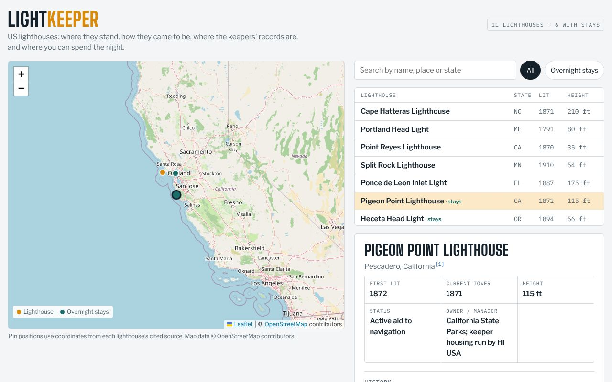

# Lightkeeper

<!-- site-summary:start -->
<!-- This section is this project's card on https://mendus59.github.io and is copied there daily.
     Keep it true of what's on main: one plain-text summary line (max 160 characters), then 1-6 short bullets.
     See CLAUDE.md ("Site summary"). -->
A map and catalogue of US lighthouses with sourced histories, keepers' records and places you can stay the night.

- Browse lighthouses on a map, or search the list by name, place or state.
- Filter to lighthouses and keeper's quarters that offer overnight stays, with booking details.
- Each lighthouse has key facts, a short history, where its keepers' logs and journals are held, and links to public sites.
- Every fact is cited to a numbered source with the date it was read.
- Each lighthouse has its own shareable link.
<!-- site-summary:end -->

<!-- site-icon: public/favicon.svg -->
<!-- site-screenshot: docs/screenshot.jpg -->


A catalogue of US lighthouses: a map, a short sourced history of each one, where its keepers' logs and journals are held, links to public sites about it, and booking details for lighthouses and keeper's quarters that offer overnight stays.

**Live site:** https://mendus59.github.io/Lightkeeper/

## Data rules

- Every fact, history and booking link cites a source in `data/lighthouses.json`, with the date it was read.
- Nothing is written from memory. If a source doesn't say it, it isn't in the data.
- Copyrighted sites (Lighthouse Digest, Lighthouse Friends and similar) are linked, not copied.
- Booking details change. Each stay carries a `checked` date so stale links can be found and rechecked.

`npm run validate` checks the data (coordinates, source ids, https links, dates) and runs before every build.

## Development

```sh
npm install
npm run dev      # local dev server
npm run build    # validate data, type-check, build to dist/
```

## Deployment

`.github/workflows/deploy.yml` builds every pull request and deploys `main` to GitHub Pages. In the repository settings, Pages must be set to deploy from **GitHub Actions**.

## Stack

Vite, React, TypeScript, Leaflet with OpenStreetMap tiles. Data lives as versioned JSON in `data/`.
